# OpenLAMT

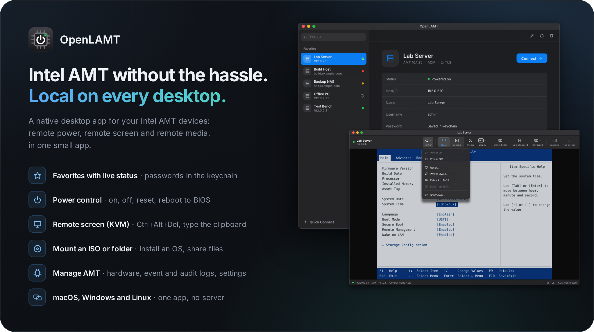

**A local desktop app for Intel AMT, native on macOS, Windows and Linux: switch your devices on and off, use their screen and serial console, boot them from an ISO and manage their AMT settings, without a browser or a server.**

<br>

<p align="center"><a href="https://www.buymeacoffee.com/michaelmayer"></a></p>

<br>

## Install

Download the file for your system from the [Releases page](https://github.com/Srv-02/openlamt/releases):

```text
macOS (Apple Silicon)   OpenLAMT-<version>-macos-arm64.zip
Windows (x64)           OpenLAMT-<version>-windows-x64.zip
Linux (x64)             OpenLAMT-<version>-linux-x64.deb
```

Start OpenLAMT and connect to your first device with **Quick Connect**. The builds are not code-signed, so macOS and Windows warn on the first launch: see [Manual install](#manual-install).

## Features

### One app on every desktop

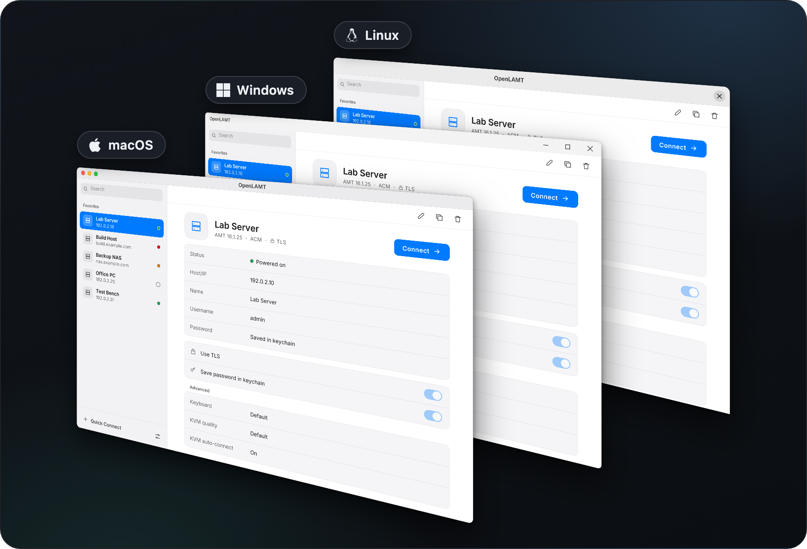

The same app runs on macOS, Windows and Linux. No browser and no server in between.

### All your devices at a glance

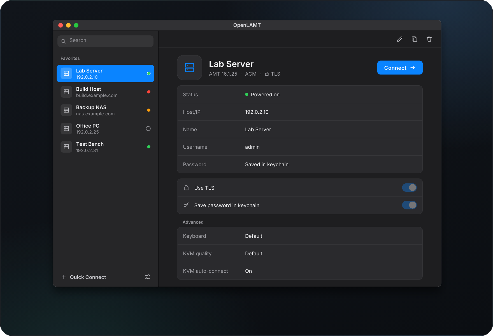

Favorites keep each device with its settings, and a colored dot shows its power state. Passwords stay in the system keychain, never in a file.

### Power and remote screen in one window

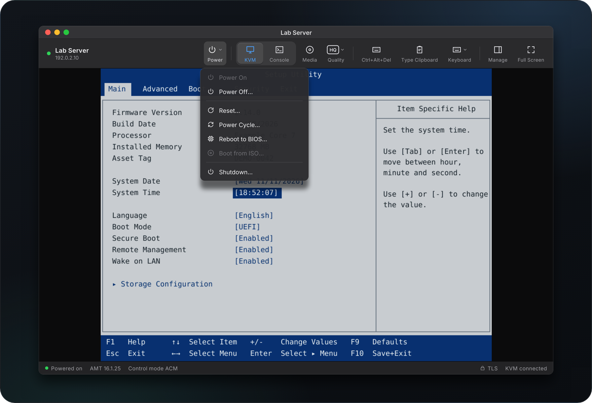

Each device opens in its own window with remote keyboard, video and mouse (KVM). Power on, power off, reset, power cycle, reboot into the BIOS, boot from a mounted ISO or shut down from the same toolbar.

### Boot from an ISO or a folder

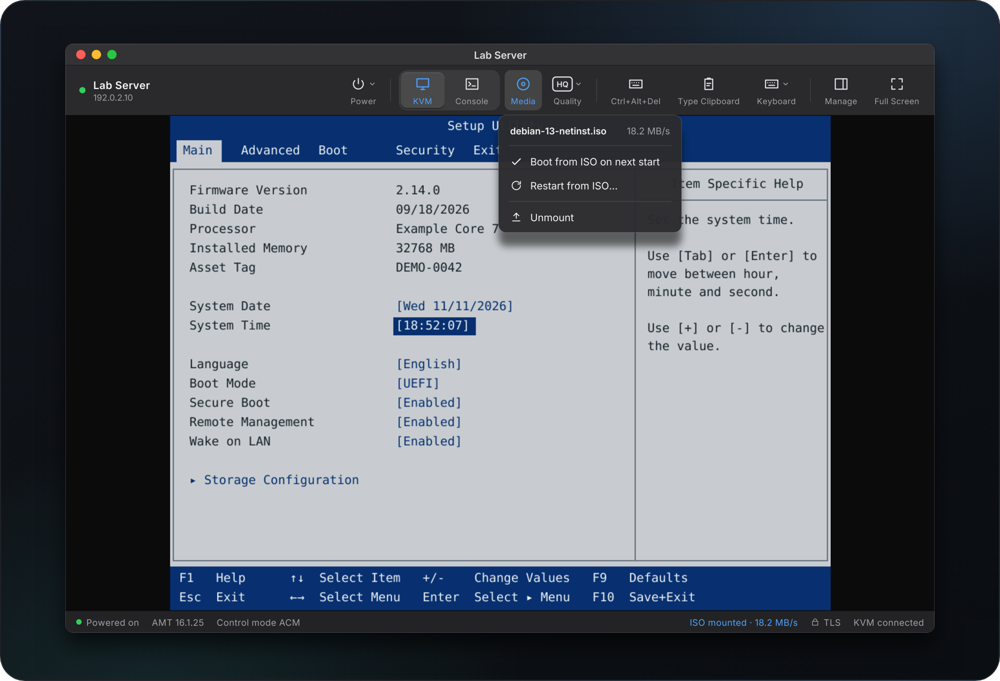

**Media** mounts an ISO file on the device as a CD drive (IDE-R). A folder works as well: OpenLAMT turns it into an ISO first. Tick **Boot from ISO on next start**, or restart the device from the ISO right away, for example to install an operating system or run a firmware update.

**Share files without a USB stick.** Mount a folder to bring files from your computer to the device, such as drivers, firmware, tools or scripts. They show up there as a read-only CD drive, with no network share to set up.

### Serial console

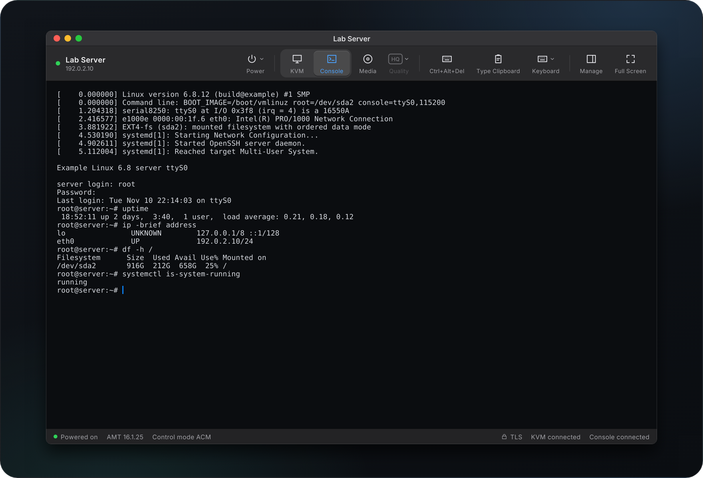

**Console** shows the serial console of the device over Serial over LAN (SOL), for example the login prompt of a Linux server with a serial console. Switch between **KVM** and **Console** in the toolbar, also in full screen. **Type Clipboard** works in the console too.

### Device management next to the screen

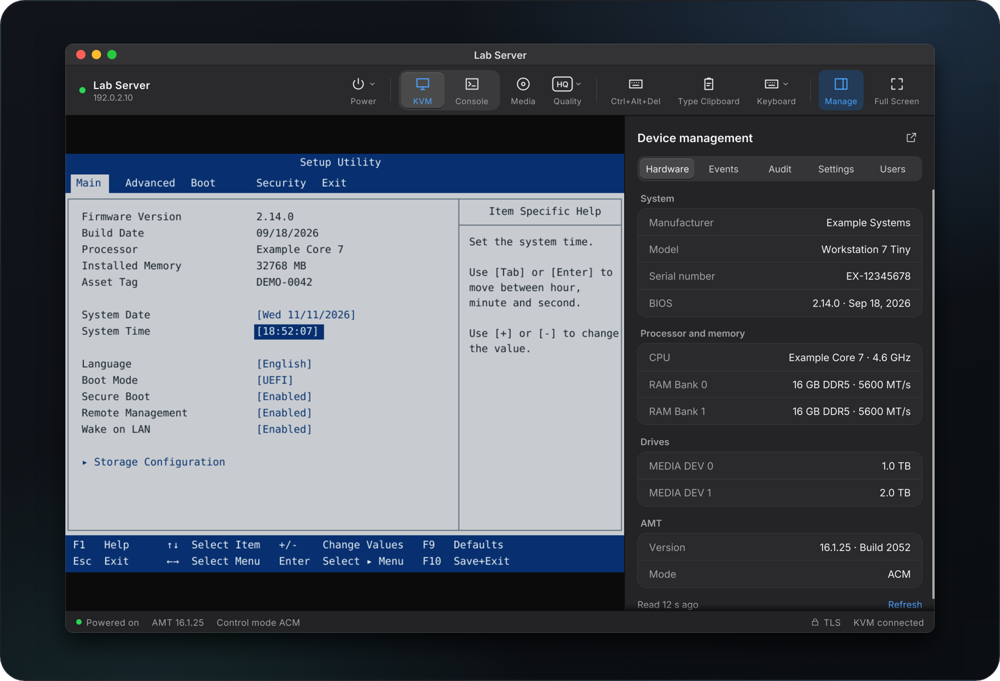

**Manage** opens a sidebar next to the remote screen, or a window of its own, with five pages: hardware, event log, audit log, AMT settings and user accounts. The hardware page lists system, BIOS, processor, memory, drives and the AMT version.

### Event log and audit log

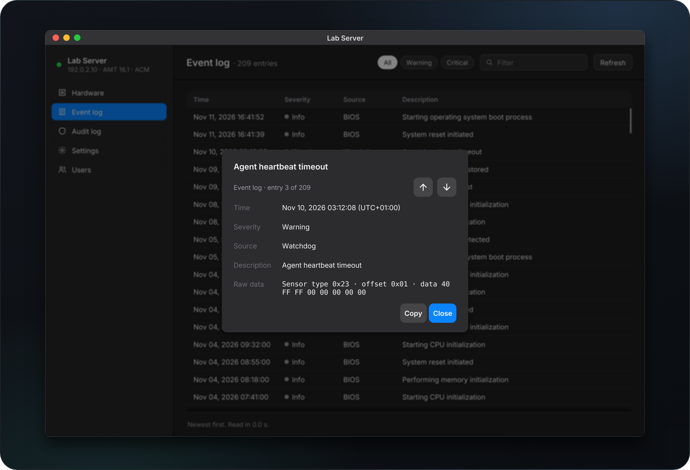

Both logs can be filtered by text, the event log also by severity. Click an entry to see every field in full, including the raw data. The arrow buttons and the Up and Down keys step through the list, **Copy** puts the entry on the clipboard.

### AMT settings and user accounts

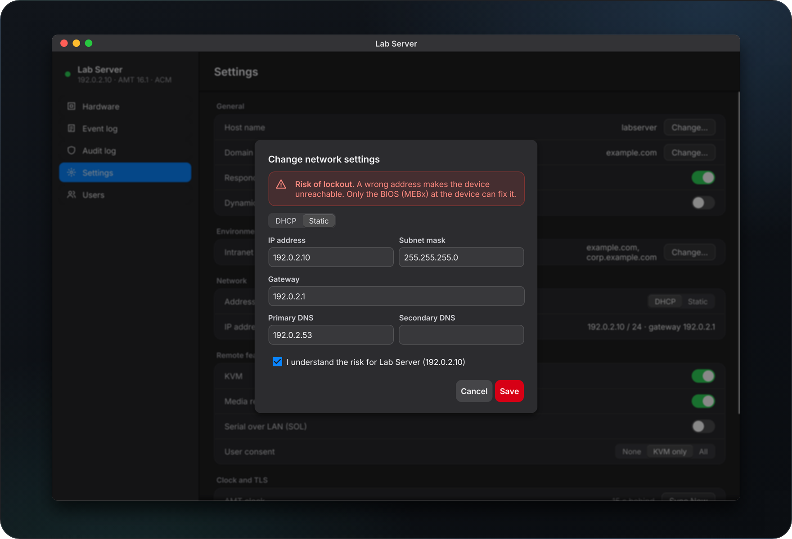

Change host name and domain, ping response, Dynamic DNS, environment detection, the network address (DHCP or static), the remote features (KVM, media redirection, Serial over LAN, user consent) and the TLS certificate. Set the AMT clock to the time of your computer, or turn AMT off on the network. **Users** adds, edits and deletes AMT accounts with their permissions and changes the admin account.

OpenLAMT does not lock these settings away. A change that can cut you off from the device says what is at stake and only goes ahead once you tick a checkbox with the device's name.

### Trust on first connect

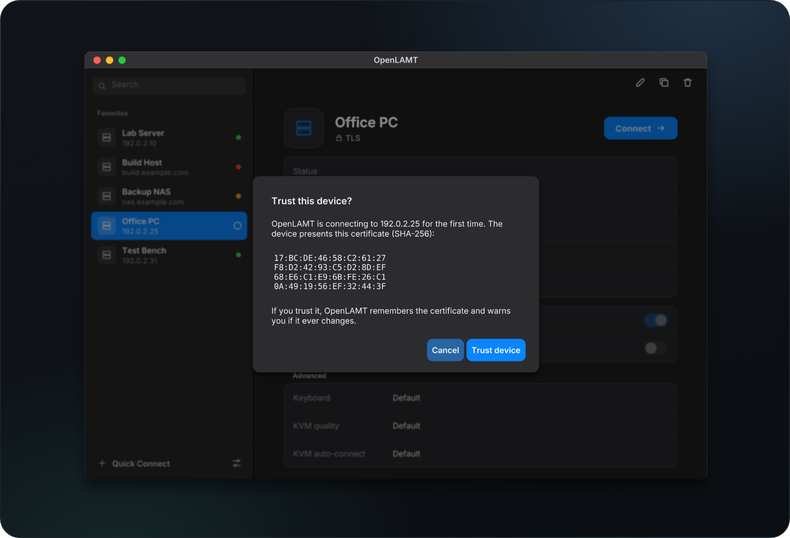

The first TLS connection shows the certificate fingerprint of the device. OpenLAMT remembers it and stops the connection if it ever changes. If you switch the TLS certificate of the device in OpenLAMT, it updates the saved fingerprint itself.

### Your language, your look

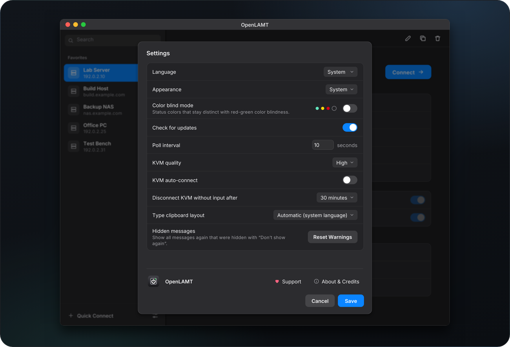

English or German, light, dark or system appearance, and status colors for red-green color blindness. Type the clipboard into the remote system in 16 keyboard layouts. **Reset Warnings** brings back every message you hid with "Don't show again".

## Details

### Requirements

- Devices with Intel AMT enabled and reachable over the network (ports `16992` to `16995`).
- macOS on Apple Silicon (arm64), Windows on x64 or Linux on x64 (`.deb`). macOS on Intel, Windows on arm64 and Linux on arm64 are not supported.
- Linux: a Secret Service provider such as GNOME Keyring or KeePassXC to save passwords.
- Media and Console use the AMT features media redirection (IDE-R) and Serial over LAN (SOL). If one of them is disabled on the device, OpenLAMT asks whether to enable it.

### Manual install

**macOS**

1. Download `OpenLAMT-<version>-macos-arm64.zip` from the [Releases page](https://github.com/Srv-02/openlamt/releases).
2. Unzip it and drag `OpenLAMT.app` to `/Applications`.
3. The app has only an ad-hoc signature, so Gatekeeper blocks the first launch. On macOS 15 Sequoia and later, right click > Open no longer works around this. Try to open the app once, then click "Open Anyway" for OpenLAMT in System Settings > Privacy & Security. Or remove the quarantine attribute in a terminal:

   ```sh
   xattr -dr com.apple.quarantine /Applications/OpenLAMT.app
   ```

**Windows**

1. Download `OpenLAMT-<version>-windows-x64.zip` from the [Releases page](https://github.com/Srv-02/openlamt/releases).
2. Unzip it and start `OpenLAMT.exe`. No installer is needed.
3. The executable is not code-signed, so Windows SmartScreen shows "Windows protected your PC" on the first launch. Click "More info" and then "Run anyway".

**Linux**

1. Download `OpenLAMT-<version>-linux-x64.deb` from the [Releases page](https://github.com/Srv-02/openlamt/releases).
2. Install it (Debian, Ubuntu and derivatives). apt resolves the required libraries (OpenGL, X11 or Wayland):

   ```sh
   sudo apt install ./OpenLAMT-<version>-linux-x64.deb
   ```

3. Start OpenLAMT from the application menu or with `openlamt`. The package recommends `gnome-keyring`; without a running Secret Service provider OpenLAMT cannot save passwords.

### Configuration

Everything is set in the app: **Settings** (the sliders icon next to **Quick Connect**) holds language, appearance, color blind mode, the update check, the poll interval, KVM quality, KVM auto-connect, the KVM idle timeout, the keyboard layout for typing the clipboard and **Reset Warnings** for messages hidden with "Don't show again". A favorite can override keyboard, KVM quality and KVM auto-connect for its device. The language changes the next time OpenLAMT starts.

### Keyboard

Key combinations that the local operating system reserves, such as Ctrl+Alt+Del, Cmd+Tab and, on Windows, Win+L, do not reach the remote system. For this reason the device window has its own **Ctrl+Alt+Del** button.

### Media

- Mount ISO images (CD and DVD). Floppy and disk images (`.img`) are not supported.
- A mounted folder becomes an ISO with the folder's files, each smaller than 4 GiB. Large folders take a moment to prepare. The device can boot from a folder over UEFI if it contains `EFI/BOOT/BOOTX64.EFI`, not in legacy BIOS mode.
- An image stays mounted until you unmount it or close the device window. Closing the window or quitting OpenLAMT with an image mounted asks first.
- On macOS and Windows, **Mount ISO** and **Mount Folder** open the file dialog of the system; on Linux, OpenLAMT shows its own.

### What it runs and touches

- **Programs:** none. On macOS, the Media file dialog uses `osascript`. Links open in your browser.
- **Files:**
    - `openlamt/favorites.json` in your configuration folder (`~/Library/Application Support`, `%AppData%` or `~/.config`)
    - passwords and certificate fingerprints in the system keychain (services `openlamt` and `openlamt-fingerprint`)
    - temporary ISOs of mounted folders in `OpenLAMT/ider` in your cache folder (`~/Library/Caches`, `%LocalAppData%` or `~/.cache`), deleted on unmount
    - downloaded updates in `~/Downloads`, only when you ask for one
- **Your devices:** OpenLAMT changes nothing you did not start, and risky changes need a confirmation.
- **Network:** your AMT devices on ports `16992` to `16995`. One update check per start to `api.github.com`, which you can turn off in Settings.

### Updates

At start OpenLAMT asks GitHub for its latest release. If it is newer, a window shows the first lines of its release notes and offers the package for your platform. The download is checked against the SHA-256 checksum GitHub states and saved to `~/Downloads`. Nothing is installed: replace the app by hand. The request carries no account, token or data about your devices, but GitHub sees your IP address.

### Removing

1. Delete the app (`OpenLAMT.app`, the folder with `OpenLAMT.exe`, or `sudo apt remove openlamt`).
2. Delete the `openlamt` folder in your user configuration folder and, if present, the `OpenLAMT` folder in your user cache folder.
3. Optionally delete the keychain entries of the services `openlamt` and `openlamt-fingerprint`.

### Development

Requirements: Go in the version given in `go.mod` and a C compiler (cgo is required by Fyne). macOS: Xcode Command Line Tools (`xcode-select --install`). Windows: a MinGW-w64 gcc, for example from MSYS2. Linux: development packages for OpenGL and X11/Wayland, for example `libgl1-mesa-dev xorg-dev libwayland-dev libxkbcommon-dev` on Debian or Ubuntu.

```sh
git clone https://github.com/Srv-02/openlamt.git
cd openlamt
go build -o openlamt ./cmd/openlamt   # build and run with ./openlamt
go vet ./... && go test ./...          # checks
```

To create a macOS application bundle, install the Fyne command line tool in the version the release workflow uses (see `.github/workflows/release.yml`) and package the application:

```sh
go install fyne.io/tools/cmd/fyne@v1.7.4
fyne package --os darwin --src cmd/openlamt \
  --app-id io.github.srv02.openlamt --name OpenLAMT --app-version 1.1.0 --release
codesign --force --deep -s - OpenLAMT.app
```

To build the Linux `.deb` from the binary (`dpkg-deb` is required):

```sh
go build -ldflags '-s -w' -o openlamt ./cmd/openlamt
packaging/linux/build-deb.sh openlamt 1.1.0 OpenLAMT_1.1.0_amd64.deb
```

## Credits

The KVM, Serial over LAN and IDE-R clients are Go ports of Intel's [ui-toolkit](https://github.com/device-management-toolkit/ui-toolkit) (Apache-2.0). Power control, device management and WS-Man through [go-wsman-messages](https://github.com/device-management-toolkit/go-wsman-messages) (Apache-2.0); code derived from [MeshCommander](https://github.com/Ylianst/MeshCommander) (Apache-2.0). Built with [Fyne](https://github.com/fyne-io/fyne) (BSD-3-Clause), [fyne-io/terminal](https://github.com/fyne-io/terminal) for the console (BSD-3-Clause), [go-keyring](https://github.com/zalando/go-keyring) (MIT) and, for the file dialogs on macOS and Windows, [zenity](https://github.com/ncruces/zenity) (MIT), set in [Inter](https://github.com/rsms/inter) (OFL-1.1). Every component and its license is listed in [NOTICE](NOTICE).

## License

Apache License 2.0, see [LICENSE](LICENSE). Third party parts keep their own licenses.

Intel and AMT are trademarks of Intel Corporation. OpenLAMT is an independent project. It is not affiliated with, endorsed by or supported by Intel Corporation.
